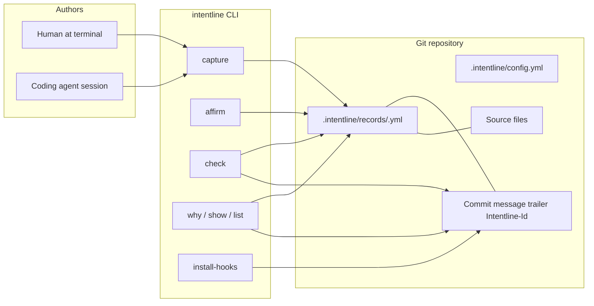
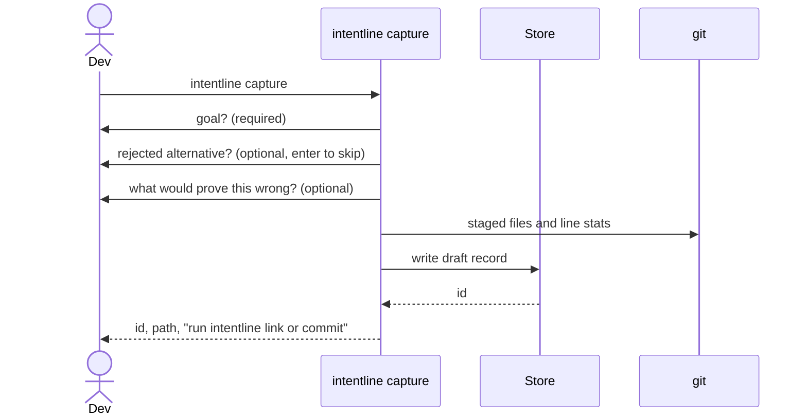

# 02 — Architecture

**Product:** Intentline  
**MVP:** CLI + git hooks, no server

## 1. Shape

Intentline is a single Python package that reads and writes files in the git repository it is run from. Git is the database. The working tree is the cache. There is no daemon.



## 2. Components

| Component | Responsibility | May do network I/O |
|---|---|---|
| `intentline.cli` | Typer commands, exit codes, help text | No |
| `intentline.models` | Pydantic models for Record, Config, HunkLink | No |
| `intentline.store` | Read/write `.intentline/records`, atomic rename, schema version | No |
| `intentline.gitio` | Trailers, blame, `git log -L`, staged diff stats, repo root | No (local git only) |
| `intentline.capture` | Build a record from flags, prompts, or a session file | No |
| `intentline.recall` | Resolve file:line or sha to records | No |
| `intentline.check` | Decide if a change is missing a record | No |
| `intentline.hooks` | Install/remove git hooks, render hook scripts | No |
| `intentline.adapters.claude` | Emit the Stop hook and draft from stdin `transcript_path` | No |
| `intentline.adapters.skill` | Render and install the portable skill and AGENTS.md snippet | No |
| `intentline.mcp` | Optional stdio MCP server. Imports CLI/store. Not imported by core | No |
| `intentline.errors` | Exception hierarchy and exit codes | No |
| `intentline.render` | Human output and `--json` output | No |

No other packages in v1. No `api/`, no `server/`, no `web/`.

## 3. Repository layout of a consumer project

```
consumer-repo/
├── .intentline/
│   ├── config.yml          # project config, committed
│   ├── schema-version      # single line, e.g. "1"
│   └── records/
│       ├── 0190....yml
│       └── 0190....yml
├── .git/hooks/
│   ├── prepare-commit-msg  # installed by intentline, not committed
│   └── pre-commit          # optional, installed by intentline
└── src/...
```

`.intentline/` is committed. Hook scripts are installed into `.git/hooks` (or a managed hooks path via `core.hooksPath` if the user already set one — detect and refuse to clobber; print the exact snippet to add).

Intentline's own repo layout:

```
intentline/
├── CLAUDE.md
├── README.md
├── LICENSE
├── CHANGELOG.md
├── pyproject.toml
├── uv.lock
├── .python-version
├── .github/workflows/ci.yml
├── skills/intentline/                 # portable agent skill
│   ├── SKILL.md
│   ├── references/
│   └── scripts/
├── templates/AGENTS.intentline.md
├── schema/record.schema.json      # generated
├── docs/                           # the specs
├── src/intentline/
│   ├── __init__.py
│   ├── cli.py
│   ├── models.py
│   ├── store.py
│   ├── gitio.py
│   ├── capture.py
│   ├── recall.py
│   ├── check.py
│   ├── hooks/                      # intentline.hooks: installer + prepare-commit-msg step
│   │   ├── __init__.py
│   │   └── prepare-commit-msg.sh   # managed block installed into .git/hooks
│   ├── render.py
│   ├── errors.py
│   ├── adapters/
│   │   ├── claude.py
│   │   └── skill.py
│   └── mcp.py                      # imported only by the intentline-mcp script
└── tests/
    ├── unit/
    ├── integration/                # real git repos in tmp_path
    └── fixtures/
```

## 4. Core flows

### 4.1 Capture (human, no agent)



Flags must be able to supply every prompt so agents and scripts never need a TTY: `--goal`, `--rejected`, `--falsifier`, `--assumption` (repeatable), `--constraint` (repeatable), `--file` (repeatable), `--affirm` (human only; refused if stdin is not a TTY unless `--i-am-human` is passed — see security doc).

### 4.2 Capture (agent)

The agent adapter does not call an LLM. It reads a session file the user or the hook points at, extracts only fields that are literally present (the user's initial prompt as `goal` candidate, files touched), and writes a **draft**. It leaves `rejected`, `assumptions`, and `falsifier` empty unless the session file contains explicit markers the adapter knows (see schema doc). Empty stays empty.

### 4.3 Link and commit

`prepare-commit-msg` hook:

1. If the message already has a `Intentline-Id` trailer, do nothing.
2. If `.intentline/pending` contains an id (written by `intentline link` or by capture with `--pending`), append the trailer and clear pending.
3. Otherwise do nothing. Do not block the commit. Blocking is the separate `pre-commit` check, and it is off by default.

### 4.4 Recall

`intentline why src/tax/close.py:88`:

1. Find repo root.
2. Ask git which commits last touched that line (`git log -L 88,88:src/tax/close.py` or blame).
3. For each candidate commit, newest first, parse trailers for `Intentline-Id`.
4. Load those records. Also load records whose `links` name that path and an overlapping line range, even without a trailer (covers records written before the commit).
5. Print status banner, goal, falsifier, rejected, assumptions, evidence, id, commit.
6. Stop at the first affirmed record unless `--all` is passed. Always show drafts that are newer than the affirmed one, marked DRAFT.

No network. No index daemon. If this is slow, the optimization is a local cache file `.intentline/index.json` rebuilt by `intentline index`, gitignored, treated as disposable. Do not build the index until a benchmark in CI shows the naive path missing the 100 ms target. YAGNI until then.

### 4.5 Check

`intentline check` (and the optional pre-commit hook):

1. Compute staged diff stat (or the range given, which must be `A..B` or `A...B`).
2. Leave out files matched by `config.check.ignore` globs (default: lockfiles, generated, `.intentline/**`). A pattern without `/` also matches the file name in any directory. Binary files count as zero lines.
3. If the remaining added+deleted lines are `< config.check.min_lines` (default 30), exit 0. This also covers a change made only of ignored files, and keeps a large lockfile from failing a small code change.
4. If a pending id exists, or HEAD / the commit range already has a `Intentline-Id`, exit 0.
5. Otherwise exit 3 and print the exact command to capture.

Default install does **not** enable the blocking pre-commit hook. `install-hooks --check` enables it. Teams opt in.

## 5. Data flow rules

- Writes to a record use temp file + atomic rename in the same directory.
- Ids are UUIDv7, lowercase hex with hyphens, as produced by the standard library (Python 3.12 has no UUIDv7 in stdlib — use a tiny internal implementation or the `uuid6`/`uuid-utils` package; prefer a well-maintained package over hand-rolled bit math. Document the choice in the issue).
- Schema version is an integer on the record (`schema_version: 1`) and in `.intentline/schema-version`. A reader that sees a higher version than it supports exits with a clear "upgrade intentline" error. It never guesses.
- Config is layered: built-in defaults < user config < project config < flags. Project config wins over user config. Flags win over both.

## 6. Trade-offs (decided)

| Choice | Why | Rejected |
|---|---|---|
| YAML records | Diffable, reviewable, hand-editable | JSON (noisier diffs), SQLite (not reviewable), prose Markdown (not queryable) |
| Git trailer as link | Travels with the commit, forge-visible, no extra pointer file required | A side index only (lost on cherry-pick), notes (easy to drop) |
| No server | Every developer can use it today; no account friction | A SaaS that would delay the actual fix |
| No LLM in core | Offline, free, no invented why | Auto-extraction that hallucinates rejected alternatives |
| Python | Owner's stack; fast to build a correct CLI; good enough for local file I/O | Rust (better binary, slower for this owner to maintain) |
| hatchling | Pure-Python friendly, no Rust toolchain forced on packagers | uv_build (can force a Rust toolchain on source builds) |
| Hooks opt-in for blocking | Adoption dies if the first commit is rejected | Always-on check |
| Draft/affirmed | Stops agent claims becoming team facts | A single status, which hides uncertainty |

## 7. Failure modes designed in

| Failure | Behavior |
|---|---|
| Not a git repo | Exit 2, message, no files written |
| `.intentline/` missing | `capture` offers to init or exits 2 with the init command. `why` exits 2 |
| Corrupt YAML | Skip with a warning in `list`; `show` exits 4 and prints the path |
| Trailer id with no file | `why` prints "record missing for id …" and continues |
| Record file with no commit | `list` shows it as unlinked. `why` can still find it via hunk links |
| Hook already present and not ours | Refuse to overwrite. Print a snippet. Exit 5 |
| `core.hooksPath` set | Refuse to write into `.git/hooks`. Print what to append. Exit 5 |
| Schema newer than binary | Exit 6, "upgrade intentline" |
| Amend of a pushed commit | Refuse. Exit 7 |
| Affirm from a non-TTY without `--i-am-human` | Refuse. Exit 8 |

## 8. Extension points (do not build, do not block)

- `links.adr`: a string path. Rendered if present, not resolved in v1 beyond existence check.
- `evidence[].command` and `evidence[].exit_code`: stored, not re-run, in v1.
- Adapters package: Claude Code first. Codex / Cursor adapters are later issues with the same contract — a script that calls `intentline capture` with flags. No framework.
- JSON Schema in `schema/` is the compatibility surface for other tools.

## 9. Performance budget

- `why` and `list` and `check`: no subprocess beyond git, no YAML parse of records that cannot match the path.
- Implementation note: for `why file:line`, get candidate SHAs from git first, then open only those record files. A record file is parsed only when its text mentions the path. Parsing every record took 728 ms on 1,000 records and missed the budget; the filtered query measured 75–84 ms.
- Benchmark lives in `tests/bench/` and is not a CI blocker until Phase 4. A simple timing test with 1,000 fixture records is enough for v1.

## 10. Observability

v1 has no telemetry. Logging:

- Default: warnings and errors to stderr.
- `--verbose`: info to stderr.
- `--json`: stdout is one JSON document; logs stay on stderr.
- No log files unless `--log-file` is passed.

Exit codes are the API. See `docs/03-schema-cli-hooks.md`.
