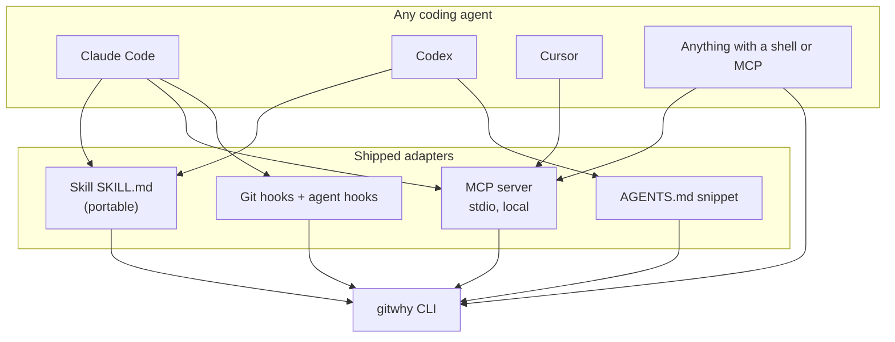

# 07 — Agent integrations

**Product:** Gitwhy  
**Status:** Required for v1, not optional  
Any coding agent must be able to use Gitwhy on any project without a custom integration written per tool. The CLI stays the source of truth. Everything else is a thin adapter over the CLI.

## 1. Goal

A developer installs Gitwhy once. On any repo, any of these agents can capture a draft and recall a reason without the human re-explaining the tool:

- Claude Code
- OpenAI Codex CLI
- Cursor
- GitHub Copilot coding agent
- Gemini CLI
- Aider, OpenCode, Cline, Continue, or anything that can run a shell or speak MCP

If an agent can do only one of the two, shell is enough. MCP is the structured path. The skill is the judgment path (when to capture, when to ask, what never to invent).

## 2. Three surfaces, one core



Rules:

1. Adapters call the CLI or the store. They do not reimplement validation.
2. No adapter may affirm a record unless the human gate in `docs/03` passes.
3. No adapter may fill `rejected`, `assumptions`, or `falsifier` from generated prose. Goal may come from the user's own message. Everything else stays empty unless the user typed it.
4. Adapters fail open. A broken hook or MCP error must not block a commit or an agent turn, except the opt-in `gitwhy check` hook.
5. No network. MCP is stdio only in v1. No hosted MCP endpoint.

## 3. What to ship

### 3.1 Portable skill

Path in this repo: `skills/gitwhy/SKILL.md`  
Also copy targets the installer writes:

| Agent | Install path |
|---|---|
| Claude Code (project) | `.claude/skills/gitwhy/SKILL.md` |
| Claude Code (user) | `~/.claude/skills/gitwhy/SKILL.md` |
| Generic / Copilot / agentskills.io | `.agents/skills/gitwhy/SKILL.md` |
| GitHub | `.github/skills/gitwhy/SKILL.md` |

One file, four copy targets. Do not fork the text.

Format: Agent Skills standard (`SKILL.md` with YAML frontmatter). Required fields `name` and `description`. Look up https://agentskills.io and the current Claude Code skills docs when you write it. Do not invent frontmatter keys.

`description` must say when to use it, in words a developer would type: "why did we do this", "record the reason", "intent", "decision", "gitwhy".

Body rules (keep it short; link to `references/` for the schema):

- Before editing a file that already has a record, run `gitwhy why <file:line>` and treat an affirmed record as a constraint. A draft is a claim, not a fact.
- After a non-trivial change, run `gitwhy capture` with `--goal` set to the user's stated goal. Do not invent rejected alternatives or assumptions.
- Never run `gitwhy affirm` unless the user explicitly said to affirm.
- If capture needs a goal and the user did not give one, ask one question. Do not guess.
- Point at `scripts/capture.sh` for the exact flag shape rather than embedding a long script in the skill body.

Layout:

```
skills/gitwhy/
├── SKILL.md
├── references/schema.md      # short field list, links to docs/03
├── references/agents.md      # per-agent install notes
└── scripts/capture.sh        # calls gitwhy capture; executable
```

### 3.2 MCP server

Entry point: `gitwhy-mcp` (console script), stdio transport only.

Implementation: check current docs at implementation time. As of 2026-10 the official `mcp` package is 2.x (`MCPServer` from `mcp.server`) and the standalone `fastmcp` package is also current. Prefer the official `mcp` SDK if its API is stable. Pin the version. Put the dependency in an optional extra:

```
gitwhy[mcp]
```

The core `gitwhy` install must not pull MCP in. `uv tool install gitwhy` stays small. `uv tool install 'gitwhy[mcp]'` adds the server.

Implemented in `src/gitwhy/mcp.py` with the official `mcp` package 2.3.0 (`MCPServer` from `mcp.server`). The process calls `run` with `transport="stdio"` only.

Tools (names are the contract):

| Tool | Maps to | Notes |
|---|---|---|
| `gitwhy_why` | `gitwhy why` | args: `path`, optional `line`, optional `commit`, optional `all` |
| `gitwhy_capture` | `gitwhy capture` | draft only. No affirm flag exposed |
| `gitwhy_list` | `gitwhy list` | |
| `gitwhy_show` | `gitwhy show` | |
| `gitwhy_check` | `gitwhy check` | returns structured pass/fail, not only an exit code |
| `gitwhy_link` | `gitwhy link` | pending only. No amend tool |

Do not expose `affirm` as an MCP tool in v1. Affirm stays a human CLI action. This is deliberate.

Resources:

- `gitwhy://schema` — JSON Schema
- `gitwhy://record/{id}` — one record
- `gitwhy://config` — effective config

Prompts: one, `gitwhy-review`, that tells the agent to load records for the changed files and answer "should this exist?" without inventing missing fields.

Server must start from the consumer repo's cwd, find the git root, and refuse to operate outside it.

### 3.3 Installer command

```
gitwhy install-agent [--claude] [--skill] [--mcp] [--agents-md] [--hooks]
gitwhy uninstall-agent
```

Default with no flags: install skill into the project (`.claude/skills/gitwhy` and `.agents/skills/gitwhy`), append the AGENTS.md block if missing, print the MCP config snippet, do not write hooks unless `--hooks`.

Idempotent. Mark managed blocks with `# gitwhy-managed` so uninstall can remove them.

MCP snippet printed (not auto-written into a global config, because that is user-machine state):

```json
{
  "mcpServers": {
    "gitwhy": {
      "command": "gitwhy-mcp"
    }
  }
}
```

Document where each agent reads that snippet (Claude Code `.mcp.json` or `claude mcp add`, Cursor MCP settings, Codex config). Look up current paths; do not guess.

### 3.4 AGENTS.md snippet

Ship `templates/AGENTS.gitwhy.md`. Installer appends it to `AGENTS.md` inside a managed block. If the file does not exist, create it with only that block.

Content, kept under 40 lines:

- What Gitwhy is (two sentences)
- Commands: `gitwhy why file:line`, `gitwhy capture --goal "..." --pending`, `gitwhy check`
- Rules: do not invent why; do not affirm; drafts are claims; affirmed records are constraints
- Pointer: skill at `.agents/skills/gitwhy/SKILL.md`

### 3.5 Claude Code hooks and plugin

Hooks: already in `docs/03`. Extend with:

- `Stop` hook: if the session edited files and no pending record exists, run capture in session mode (draft, goal from the user prompt only).
- Do not add a hook that affirms.

The Stop hook command is `gitwhy adapters claude-stop`. Claude Code sends the session file as `transcript_path` on stdin (https://code.claude.com/docs/en/hooks). Gitwhy does not hardcode `~/.claude/projects`. The hook writes one draft when that file exists, the session lists files in the repository or something is staged, and `.gitwhy/pending` is empty. It never affirms. It exits 0 when gitwhy or the session file is missing.

Plugin format is stable enough to ship. `templates/claude-plugin/` is hook-only: `.claude-plugin/plugin.json` plus `hooks/hooks.json` (the same object as the settings snippet). It does not bundle a second copy of the skill. Install the skill with `gitwhy install-agent`. Load the plugin with `claude --plugin-dir` pointed at that directory. MCP is separate: `claude mcp add --scope project gitwhy -- gitwhy-mcp` (needs `gitwhy[mcp]`).

### 3.6 Scripts

| Script | Purpose |
|---|---|
| `skills/gitwhy/scripts/capture.sh` | Stable flag wrapper agents call |
| `skills/gitwhy/scripts/why.sh` | `gitwhy why` wrapper, exits 0 with a clear "no record" line |
| `src/gitwhy/hooks/prepare-commit-msg.sh` | Template installed into `.git/hooks` |
| `src/gitwhy/adapters/claude_stop.py` | Stop-hook entry, never affirms, always exit 0 |

Scripts are POSIX sh where possible so agents on any OS can run them. Python is acceptable for the hook entry.

## 4. Per-agent support matrix (v1)

| Agent | Skill | MCP | Hooks | AGENTS.md | Notes |
|---|---|---|---|---|---|
| Claude Code | yes, `.claude/skills` | yes | yes | yes (reads it) | Primary dogfood target |
| Codex CLI | yes, copy skill | yes if it speaks MCP | no | yes, native | |
| Cursor | skill copy if it reads Agent Skills | yes | no | yes | |
| Copilot coding agent | `.github/skills` | if available | no | yes | |
| Gemini CLI / Aider / OpenCode | skill + shell | MCP if supported | no | yes | Shell fallback always works |
| Anything else | shell out to `gitwhy` | optional | no | snippet | |

Do not build a separate codebase per agent. One skill, one MCP server, one snippet, one CLI.

## 5. Agent behavior contract

Every skill, hook, and MCP tool description must repeat these:

1. Affirmed record = constraint. Do not contradict it without the user explicitly overriding. If you override, capture a new draft that names the old id in `risks` or the goal.
2. Draft record = claim. Show it, do not treat it as decided.
3. Missing record on a non-trivial change = ask for a goal, then capture. Non-trivial means the same threshold as `gitwhy check` (default 30 lines) or any change the user called a feature or a fix.
4. Never invent `rejected`, `assumptions`, or `falsifier`.
5. Never affirm.
6. Never send record contents to a network endpoint you were not already going to call. Gitwhy itself sends nothing.

## 6. Tests

- Skill file exists, frontmatter parses, `name` is `gitwhy`, `description` mentions when to use it.
- `capture.sh` with no gitwhy on PATH exits non-zero with a clear message (or the test installs the package).
- MCP server starts on stdio in a temp repo, `gitwhy_list` returns empty, `gitwhy_capture` writes a draft, `gitwhy_why` returns it. Use the SDK's in-process test client if it has one; otherwise a subprocess smoke test.
- MCP tool list does not include affirm.
- Installer is idempotent: second `install-agent` does not duplicate the AGENTS.md block or the skill.
- Uninstall removes managed blocks and leaves user text.
- Stop-hook script exits 0 when gitwhy is missing and when the session file is missing.

## 7. Docs to write alongside the code

Written:

- `docs/adapters/claude-code.md` — install skill, add MCP, enable hook
- `docs/adapters/other-agents.md` — Codex, Cursor, Copilot, generic shell. Paths were checked against current Codex, Cursor, and Copilot docs when this was written.
- README section "Use from a coding agent" with `gitwhy why`, `gitwhy capture`, `gitwhy check`, and the MCP snippet

## 8. Out of scope

- A remote/hosted MCP endpoint
- An MCP tool that affirms
- Auto-extraction of rejected alternatives via an LLM
- Per-agent forks of the skill text
- A marketplace listing (may be a Phase 5 issue once the skill is stable)
